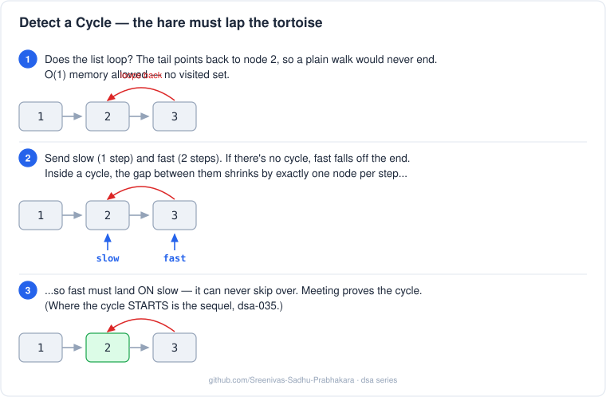

# Detect a Cycle in a Linked List

> Striver SDE Sheet 032 · Day 6 Linked List — Floyd's tortoise and hare: in a loop, a 2x pointer must lap a 1x pointer. Go, stdlib only, tested.

## Problem

Decide whether a singly linked list ever loops back on itself, in O(1) space — so no visited-set of node pointers.

## Approach

Floyd's cycle detection. Advance `slow` one step and `fast` two steps per iteration. If there is no cycle, `fast` falls off the end and the answer is no. If there is one, both pointers eventually orbit inside it, and because the gap between them shrinks by exactly one node per iteration (mod cycle length), `fast` must land *on* `slow` — not skip over it. That closing-gap argument is the whole proof, and it is why the meeting test is `slow == fast` after moving, not before.

**Complexity:** O(n) time, O(1) space.

## Visual walkthrough

Read the picture top to bottom — each numbered frame is one moment of the algorithm
running on this repo's test example.

## Run

    go test ./...   # verify
    go run .        # demo

---

One of 191 repos solving Striver's SDE Sheet in Go — stdlib only, one problem per repo, every solution tested. Browse the set: [`dsa-*` repos](https://github.com/Sreenivas-Sadhu-Prabhakara?tab=repositories&q=dsa-&type=source).
